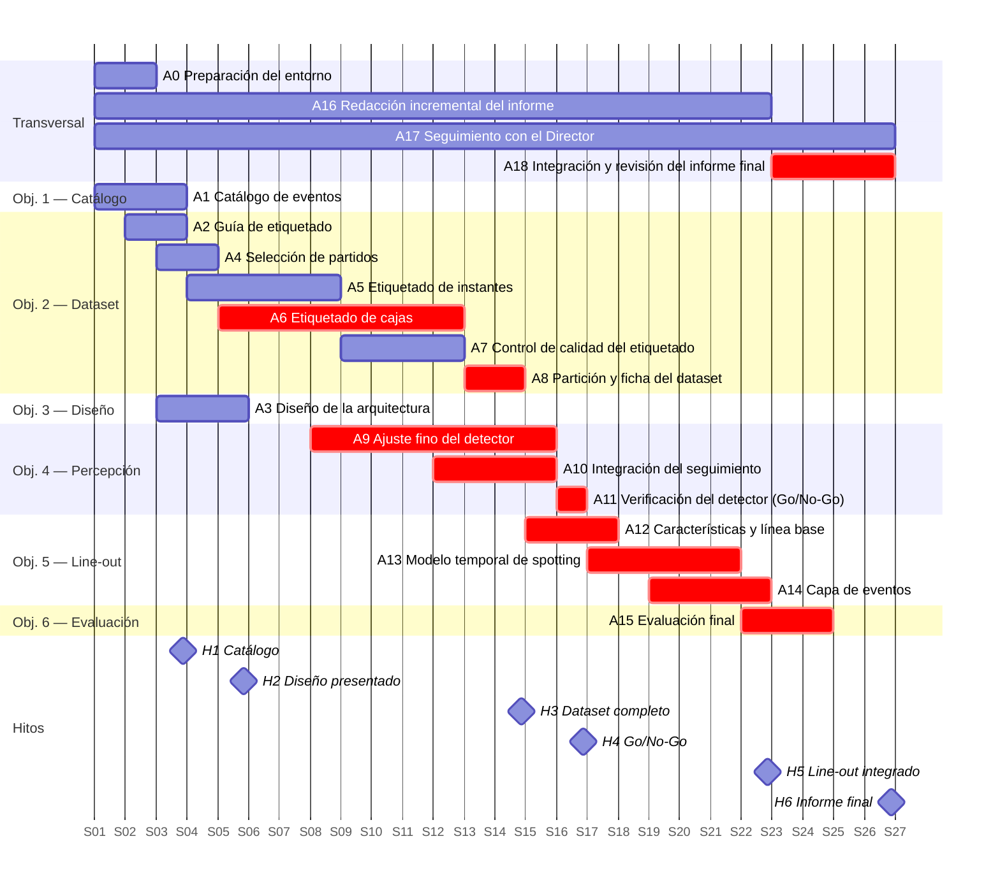

# 08 — Plan de Trabajo y Cronograma

> **Reglamento de TF — UCSE DAR, Art. 6b, inciso 8.**
> Trabajo Final de Carrera — Ingeniería en Informática.
> Autor: Juan Ignacio Abarca.

---

## 1. Plan de Trabajo y Cronograma

Este apartado detalla las actividades del proyecto, con su descripción y duración. Las actividades surgen de los *Objetivos* y del proceso definido en *Metodología* ([`06_metodologia.md`](06_metodologia.md)).

**Convenciones:**

- Los plazos se expresan en **semanas relativas** sobre una duración total de **26 semanas (≈6 meses)**. La semana 1 (S1) corresponde al inicio del desarrollo, una vez aprobado el anteproyecto (Art. 7 del Reglamento).
- La dedicación de referencia es de **≈10 horas semanales**, es decir, ≈260 horas en total.
- El desarrollo se organiza en **iteraciones de dos semanas**; cada iteración cierra con una revisión de avances respecto de este plan.
- Las **predecesoras** indican de qué actividad depende cada una. Cuando las barras se solapan, la relación es de **inicio a inicio**: la actividad comienza con los resultados parciales de su predecesora (por ejemplo, el ajuste del detector arranca con las primeras cajas etiquetadas).
- Las extensiones opcionales (*scrum*, comparación de algoritmos de seguimiento, modelo de extremo a extremo, servicio web) no se planifican: sólo se abordan si, cumplido el objetivo 5, queda holgura.

### 1.1. Actividades

| ID | Actividad | Descripción | Semanas | Duración (sem.) | Horas | Predecesoras | Entregable |
|---|---|---|---|---|---|---|---|
| A0 | Preparación del entorno | Repositorio de código, entorno de Python y PyTorch con versiones fijadas, verificación de la GPU, registro de experimentos y esquema de respaldos | S1–S2 | 2 | 6 | — | Entorno reproducible |
| A1 | Catálogo de eventos | Criterios observables del line-out (evento inicial) y especificación del scrum y el ruck como extensión, validados con el referente del club | S1–S3 | 3 | 9 | — | Documento de catálogo |
| A2 | Guía de etiquetado | Criterio del instante de lanzamiento y tratamiento de los casos dudosos | S2–S3 | 2 | 4 | A1 | Guía de etiquetado |
| A3 | Diseño de la arquitectura | Tres capas, interfaces y artefactos intermedios; presentación al Director | S3–S5 | 3 | 12 | A1 | Documento de diseño |
| A4 | Selección de partidos | Selección de partidos del plantel superior, de local y de visitante, y manifiesto con *hashes* | S3–S4 | 2 | 4 | A2 | Lista de partidos y manifiesto |
| A5 | Etiquetado de instantes | Instantes de lanzamiento hasta reunir ≈300 line-outs (≈12 partidos) | S4–S8 | 5 | 15 | A4 | Planilla de instantes |
| A6 | Etiquetado de cajas | 300–500 cuadros pre-anotados con el detector de COCO y corregidos en CVAT | S5–S12 | 8 | 24 | A0, A4 | Cuadros con cajas |
| A7 | Control de calidad del etiquetado | Reetiquetado propio de un partido (≥3 semanas después) y un partido etiquetado por el referente | S9–S12 | 4 | 8 | A5 | Medidas de acuerdo |
| A8 | Partición y ficha del dataset | Asignación de partidos completos balanceada por line-outs (≈70/15/15) y *datasheet* | S13–S14 | 2 | 6 | A5, A6, A7 | Dataset completo |
| A9 | Ajuste fino del detector | Ajuste de YOLO; se inicia con las cajas disponibles y se completa con el dataset final | S8–S15 | 8 | 24 | A3, A6 | Detector ajustado |
| A10 | Integración del seguimiento | BoT-SORT con compensación del movimiento de cámara sobre las detecciones, y artefacto de trayectorias | S12–S15 | 4 | 8 | A9 | Trayectorias por cuadro |
| A11 | Verificación del detector (Go/No-Go) | AP@0.5 de *jugador* sobre validación y decisión sobre las medidas del plan B | S16 | 1 | 3 | A8, A10 | Informe de decisión |
| A12 | Características y línea base | Características geométricas normalizadas en la imagen y reglas heurísticas | S15–S17 | 3 | 12 | A5, A10 | Series de características y línea base |
| A13 | Modelo temporal de *spotting* | Entrenamiento, posprocesamiento (NMS temporal) y verificación sobre validación | S17–S21 | 5 | 25 | A11, A12 | Modelo de reconocimiento |
| A14 | Capa de eventos | Recorte de clips, catálogo en SQLite e interfaz de línea de comandos | S19–S22 | 4 | 12 | A3, A13 | Sistema integrado |
| A15 | Evaluación final | Evaluación única sobre prueba (AP@0.5, F1 con δ = 3 s e intervalos de confianza), comparación con la línea base, tiempo de procesamiento por partido y análisis de errores | S22–S24 | 3 | 15 | A14 | Informe de evaluación |
| A16 | Redacción incremental del informe | Registro de decisiones, resultados parciales y capítulos del informe del TF a medida que avanza el desarrollo | S1–S22 | 22 | 12 | — | Borradores de capítulos |
| A17 | Seguimiento con el Director | Reuniones periódicas y registro de cada reunión | S1–S26 | 26 | 5 | — | Minutas |
| A18 | Integración y revisión del informe final | Integración del informe completo, revisión iterativa con el Director y correcciones | S23–S26 | 4 | 18 | A15, A16 | Informe final |
| | **Total** | | | | **222** | | |

Las actividades suman ≈222 horas sobre ≈260 disponibles. La diferencia, ≈38 horas (≈15 %), es una **reserva para contingencias**: cubre las medidas del plan B del punto de decisión de la S16 y los desvíos de las actividades críticas. La carga semanal estimada no supera las ≈12 horas en ninguna semana.

### 1.2. Diagrama de Gantt

Las barras marcadas en rojo forman el **camino crítico**. Las fechas del diagrama son sólo una referencia para dibujarlo: el eje se lee en semanas relativas, y cada marca indica el inicio de la semana (S27 marca el cierre de la S26).

### 1.3. Hitos

| Hito | Semana | Criterio de cumplimiento | Objetivo |
|---|---|---|---|
| H1 | S3 | Catálogo de eventos documentado y validado con el referente del club | 1 |
| H2 | S5 | Documento de diseño presentado al Director | 3 |
| H3 | S14 | Dataset etiquetado (≥200 line-outs), con control de calidad y partición | 2 |
| H4 | S16 | Módulo de percepción verificado sobre validación (AP@0.5 de *jugador*) y decisión Go/No-Go tomada | 4 |
| H5 | S22 | Line-out reconocido y clips generados por el sistema integrado, verificado sobre validación | 5 |
| H6 | S26 | Evaluación única sobre prueba documentada e informe del TF revisado | 6 |

### 1.4. Camino crítico y holguras

El camino crítico pasa por el **etiquetado de cajas** (A6) y la **partición del dataset** (A8), el **ajuste del detector y el seguimiento** (A9 a A11), las **características y el modelo temporal** (A12 y A13), la **capa de eventos** (A14), la **evaluación final** (A15) y la **revisión del informe** (A18). El etiquetado de instantes (A5) no es crítico: termina en la S8 y tiene holgura hasta la partición. Para reducir el riesgo del camino crítico:

- el ajuste del detector (A9) comienza en la S8 con las cajas ya etiquetadas, sin esperar el dataset completo;
- las medidas del plan B del Go/No-Go se financian con la reserva para contingencias;
- la redacción del informe avanza en paralelo (A16), de modo que las últimas semanas (A18) se dedican a integrar y revisar, no a escribir desde cero.

---

*Los apartados subsiguientes del anteproyecto se desarrollan en los archivos correspondientes del directorio `docs/anteproyecto/`.*
